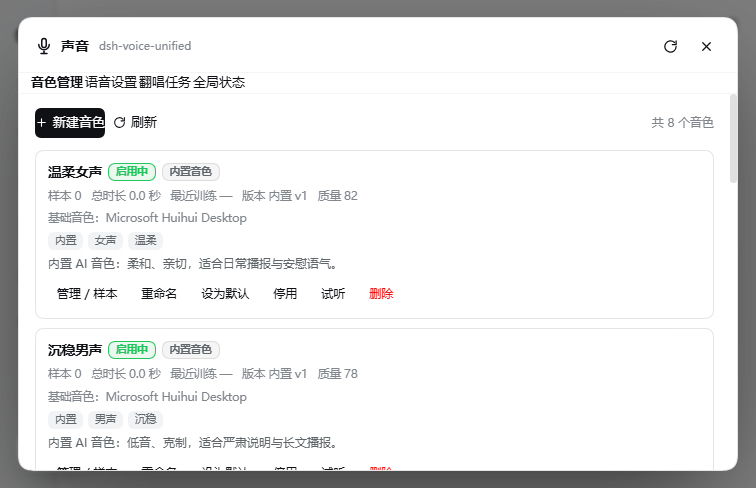
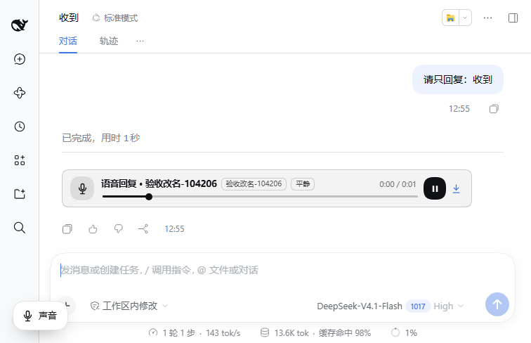
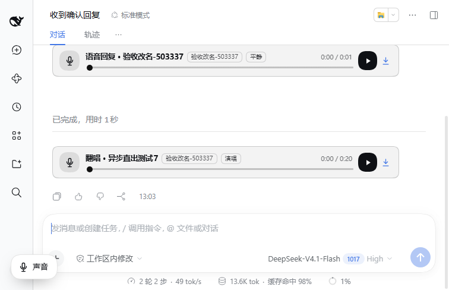

# dsh-voice-unified

> 一个 DSH 插件，统一管理多音色、音色进化、情感 TTS、翻唱换声直出、音乐缓存联动与管理界面。
> 音频默认全部在本机处理；不把样本、对话或音频上传到云端。







## 能力一览

| 能力 | 实现 |
|---|---|
| 多音色档案 | 创建、命名、描述、标签、删除、启用/停用；每个档案独立管理样本、训练版本、试听记录 |
| 全局默认音色 | 全局唯一默认，按需语音回复与默认翻唱使用它；可随时切换 |
| 临时音色 | `voice.speak` / `voice.cover.run` 可临时指定档案，不改变全局默认 |
| 样本与进化 | 上传/录音/参考音频、追加样本、静音切片、质量检测、时长统计、增量训练、版本回滚 |
| 情感语音 | 平静、开心、温柔、严肃、安慰、兴奋、低落；情绪/语速/音调/停顿参数；跨轮情绪；可重置 |
| 翻唱流水线 | STFT 中置软掩码分离 → 音色转换 → **默认清唱+伴奏**（主唱清晰、原唱人声关闭）→ MP3/WAV；异步队列、日志、重试、导出 |
| 按需语音 | **默认不自动播报**；只有用户明确说“唱/说/语音/朗读/翻唱”等时才生成；语音回复省略过程说明 |
| 直出语音回复 | 按需语音或翻唱完成后默认写入当前会话，对话内直接播放；失败不阻塞普通对话 |
| 右键转文字 | 右键对话内语音播放器查看/复制文本；TTS 优先用原始文本，其他音频走本地识别 |
| 微信式语音 | 回复与翻唱统一显示为微信式语音气泡，按时长自适应宽度 |
| 音乐插件联动 | 接收缓存文件路径/URL/歌曲名；监听缓存目录；可直接抓取音乐插件当前音频流 |
| 管理界面 | 设置页「声音」入口或 Ctrl+Shift+V 打开管理面板，四页：音色管理、语音设置、翻唱任务、全局状态；面板标题栏可拖动 |
| 工具接口 | 14 个命令的完整参数与返回；同时提供 DeepSeek 可调用的下划线别名与统一 `voice` 入口 |

## 安装

完整步骤见 [INSTALL.md](INSTALL.md)。

```powershell
# 在插件目录执行；profile 名按你的 DSH 安装替换
dsh plugin --profile desktop add "link:C:\绝对路径\dsh-voice-unified"
# 重启 DSH 后生效
```

要求 Windows 10/11 x64、DSH ≥ 0.2.1、可用的 Windows SAPI 中文音色（系统自带
`Microsoft Huihui Desktop`）、DSH 自带 Python + numpy。ffmpeg 已随包提供。

## 快速使用

1. 在「设置 → 声音」或按 Ctrl+Shift+V 打开面板 →「音色管理」→「新建音色」。
2. 上传 2~4 段 3~15 秒清晰人声（支持 wav/mp3/m4a/flac/ogg），点击「训练」。
3. 训练完成后点「试听」；满意后点「设为默认」。
4. 默认不会自动读每条回复；只有你说“唱一下/说一句/用语音/朗读/翻唱”等时，才会生成语音。
   也可以在「语音设置」打开「始终语音回复」。
5. 翻唱：在「翻唱任务」选择音乐缓存文件（或本地上传），选择音色，点「开始翻唱」。
   默认完成后直接作为语音回复发送到当前会话，同时保留 MP3/WAV 导出。
6. 右键对话里的语音播放器 →「转文字」，可查看并复制文本；TTS 语音优先显示原始文本，
   翻唱/其他音频走本地识别（可能不完全准确）。

## 工具名与 DeepSeek 平台限制（重要）

需求中的 14 个命令名包含点号。DeepSeek API 的工具名只接受
`^[a-zA-Z0-9_-]+$`，直接把 `voice.profile.create` 注册给模型会导致整个请求
`INVALID_REQUEST`。因此插件默认：

- 注册 **DeepSeek 可调用的下划线别名**：`voice_profile_create`、`voice_profile_add_sample` ……
- 同时注册 **统一入口** `voice`，`action` 使用**精确点号命令名**（如
  `voice.profile.create`），`params` 为参数对象。命令词汇、参数和返回保持完全一致。
- 点号工具名仍保留为 `DSH_VOICE_DOTTED_TOOLS=1` 可选开启，供工具名语法允许点号的宿主使用。

详细对照见 [docs/TOOLS.md](docs/TOOLS.md)。

## 数据位置

默认 `~/.dsh/dsh-voice-unified/`，可用 `DSH_VOICE_HOME` 覆盖：

```text
state.json              音色、版本、设置、队列、情绪状态
samples/<profile>/      原始样本与解码后的 24k WAV
audio/replies/          自动/手动语音回复
audio/previews/         训练版本试听
audio/covers/           翻唱成品 MP3/WAV/预览
cache/                  从音乐插件抓取的音频
temp/                   引擎临时文件
```

## 文档

- [安装与升级](INSTALL.md)
- [配置文档：音色、训练、情感、翻唱、音乐缓存、直出设置](docs/CONFIG.md)
- [工具接口文档](docs/TOOLS.md)
- [架构与引擎替换](docs/ARCHITECTURE.md)
- [已知限制与故障排查](docs/LIMITATIONS.md)
- [最低与推荐硬件配置](docs/HARDWARE.md)
- [验收标准逐项自测](docs/ACCEPTANCE.md)
- [示例音频与验收脚本](examples/README.md)

## 自测

```powershell
# 纯引擎测试（102 项）
node tests/engine/run-tests.mjs

# 核心链路：建档、样本、训练、试听、情感、翻唱直出
node tests/core-smoke.mjs
node tests/cover-smoke.mjs
node tests/emotion-smoke.mjs

# 对运行中的隔离 DSH 实例跑 22 项 live 验收
node tests/live-acceptance.mjs http://127.0.0.1:61999

# 真实浏览器 CDP UI 冒烟（需 Edge 远程调试）
node tests/ui-cdp.mjs
```

## 更新日志

### 1.6.2

- 界面：对话内「微信式语音消息气泡」整体缩小，与聊天正文比例更协调。
  - 宽度公式从 `96 + 时长×4.6`（上限 238）改为 `64 + 时长×2.6`（上限 170），29 秒语音约 139px。
  - 最小高度 40→30px，内边距 8/13/8/11 → 6/10/6/8，圆角 18→15px。
  - 麦克风图标 22→17px，波形条 18→13px（条宽 3→2px），时长字号 13→11.5px，小尾巴 7×12→6×10px。

## 许可

插件代码 MIT。随包 `bin/ffmpeg.exe` 为 GPL 构建，见 `NOTICE-ffmpeg.txt`。
